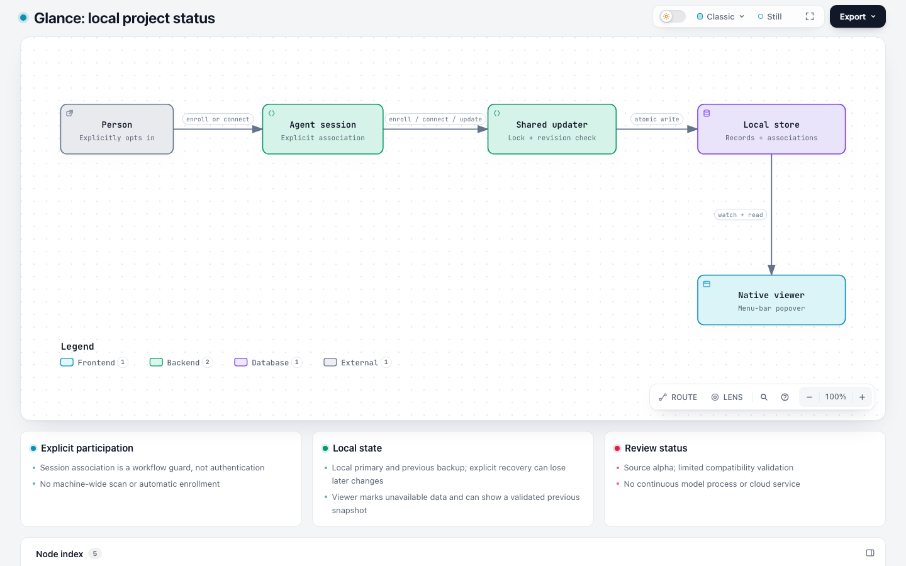
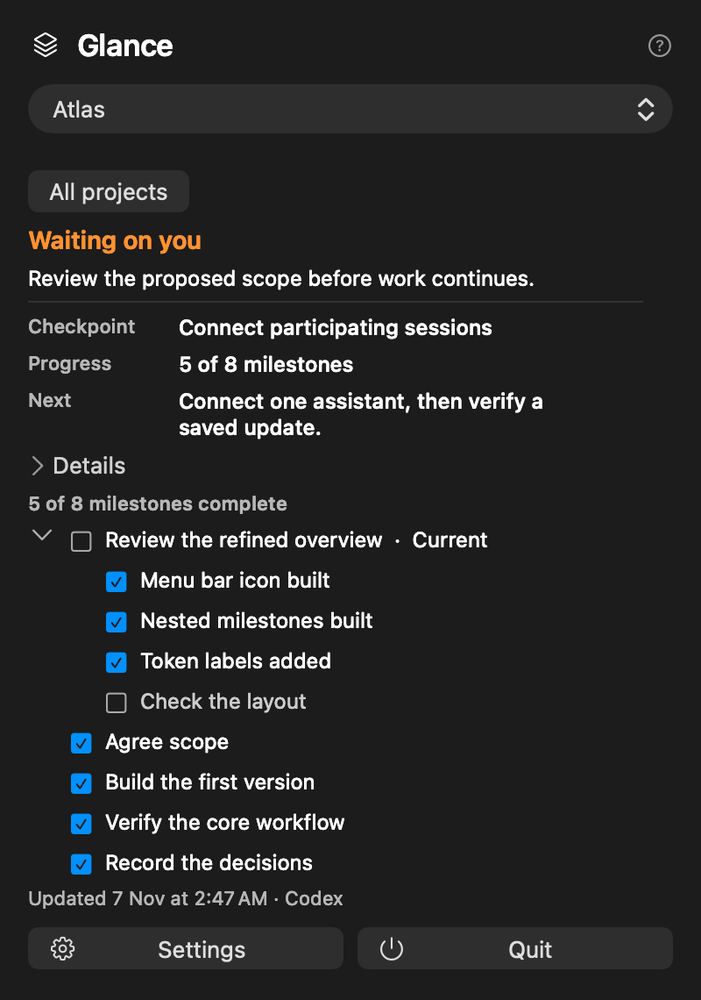

# Glance: local macOS menu-bar project status for AI-assisted work

Glance is an early **0.2.2 alpha source build** for keeping a small set of explicitly enrolled projects visible in a macOS menu-bar popover. A person or an associated AI agent supplies each checkpoint; Glance does not discover projects or run a model.

**New in 0.2.2 (7 November 2026):** Read-only listing works without write access to the store lock. Writes still require access to the store directory.

<picture>
  <source media="(prefers-color-scheme: dark)" srcset="docs/architecture-dark.png">
  
</picture>



*Glance with fictional example data.*

[Architecture details](docs/ai/architecture.html) · [Changes in 0.2.2](CHANGELOG.md)

## Build and run from source

Requires macOS, Apple's Command Line Tools (including Swift), and Python 3 for the tests. The build uses the installed Swift toolchain's default deployment target; it does not declare a macOS minimum. The local source build was checked on macOS 26.6.2, Apple silicon, with Swift 6.3.3; its viewer binary reports a macOS 26.0 minimum. Compatibility across other macOS versions has not been established. The local app is ad-hoc signed, not Developer ID signed or notarized.

```sh
scripts/build.sh
python3 tests/store.py
python3 tests/read_only_store.py  # run as a non-root user
python3 tests/improvements.py
python3 tests/release_reliability.py
scripts/show.sh
```

The build creates `build/ProjectOverview.app` and `build/glance-store`. The show script opens its popover. Ordinary launch remains silent; click the menu-bar icon to open or close it, and use Quit in the popover to exit. For an optional local installation, `scripts/install.sh` installs to `~/Applications/Glance.app` and refuses an unrecognized existing app. Rebuild and rerun the installer to update it. This is source installation, not a distributed or notarized binary.

## Install with an AI agent

Give an agent this repository and this prompt:

> Read the README and project instructions. Build and test Glance from source, explaining any failures. Do not install the app or agent skills, change login settings, enroll projects, scan my files, or import conversations unless I explicitly ask. Use a temporary store for experiments.

To opt in to the Codex router after installing the app, run `scripts/install-agent-skills.sh --codex-only`. Without that flag the script targets both Codex and Claude skill homes; use it only when both are intended. It refuses unmanaged existing skills. A new chat may be needed to discover a newly installed router.

## Frequently asked questions

### How do I add or update a project?

Ask an agent to add a specific project to Glance, or use `build/glance-store` directly. Each new chat must be explicitly connected before it can update an existing project. The [agent guide](docs/agent/AgentGuide.md) contains the payload format, commands, version checks and readback procedure. Use `--store DIRECTORY` before a command to experiment with a separate store. Only explicit enrollment creates a store; launching or installing the app does not enroll data.

### Where is my data stored?

The default is `~/Library/Application Support/ProjectOverview/` on your Mac. The viewer reads local data; Glance does not upload it, search your computer, import conversations, or start a model. Do not put secrets, raw prompts or transcripts into status fields. Session association coordinates cooperating agents; it is not protection against other local processes.

### What happens if the store is unavailable?

The viewer marks unavailable data and may display its last valid in-memory view or a previous validated backup. The backup can omit later updates. Writes reject a missing or invalid primary when a backup exists. **Recovery is explicit and can lose later changes**: inspect and preserve the files, then follow the digest-checked recovery procedure in the [agent guide](docs/agent/AgentGuide.md#explicit-migration-and-recovery). The backup and primary are separate replacements, not one transaction. A write error can leave the outcome uncertain; read the current state before retrying. Power-loss behavior has not been tested.

### Does it start at login?

The Settings control offers an optional macOS-managed login item; it is not enabled automatically. Login-item behavior has not been verified. Sleep/wake, Spaces and display changes also need further testing.

### What is the release status?

This is an early source build, not a consumer-ready release. The name is provisional; independent Astra source-alpha review passed on 7 November 2026 (solo:codex, with same-provider blind spots). Local UI and source review evidence is recorded in [current state](docs/ai/CURRENT_STATE.md) and [review history](docs/ai/reviews/2026-11-07-compact-board.md); it does not establish compatibility on other machines. The [project contract](docs/ai/README.md) describes development and review requirements.

## License

[MIT](LICENSE).

## Keywords

macOS menu bar, project status, local AI agent workflow, project checkpoint, Codex, Claude Code, explicit enrollment
