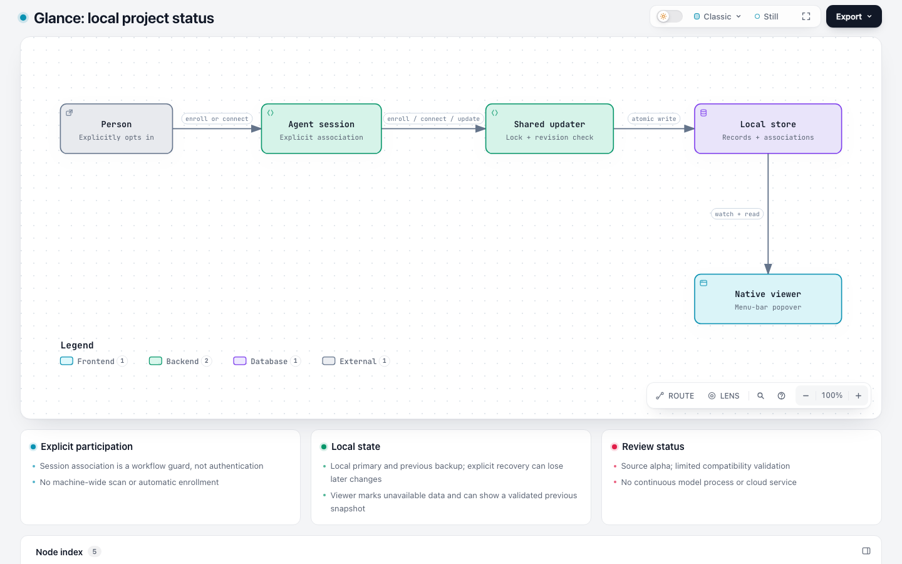
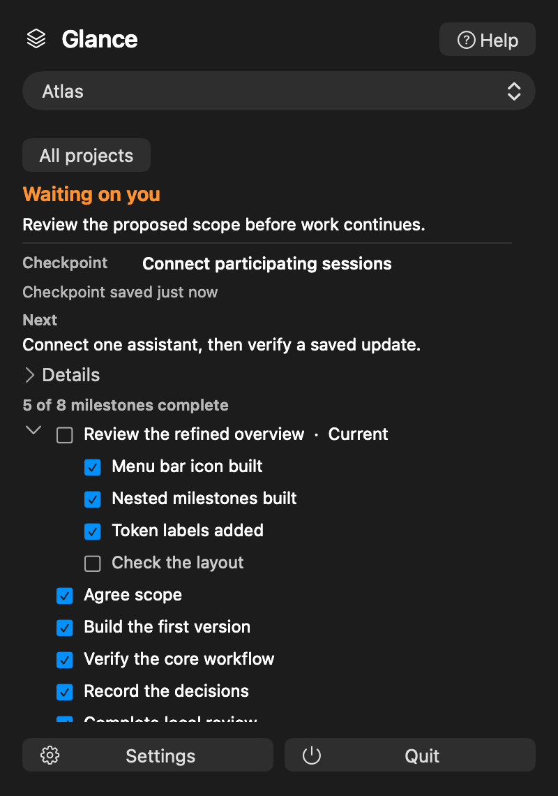
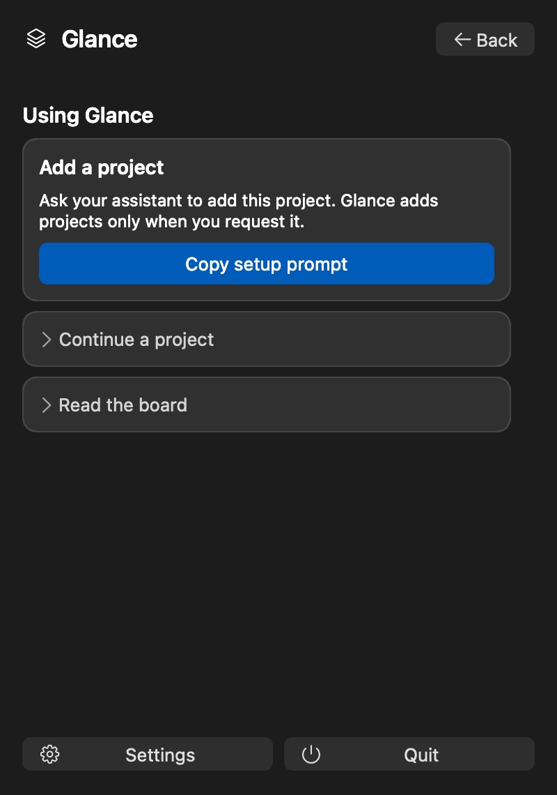

# Glance — local macOS menu bar project tracker for Codex and Claude Code

Glance is a native macOS menu bar app for tracking the projects you work on with AI coding agents. Open it to see the goal, saved checkpoint, next action and milestone checklist for projects you explicitly add. Glance stores the status on your Mac and works with Codex, Claude Code or another agent that can run the local updater.

**New in v0.3.0 (21 November 2026).** Click outside to dismiss the popover. The new Help view puts the setup prompt up front. The project board shows when the checkpoint was saved and lets you expand long next actions.

<picture>
  <source media="(prefers-color-scheme: dark)" srcset="docs/architecture-dark.png">
  
</picture>

| Project board | Setup and Help |
| --- | --- |
|  |  |

*Screenshots use fictional project data.* [Changes by version](CHANGELOG.md) · [Agent guide](docs/agent/AgentGuide.md) · [Architecture details](docs/ai/architecture.html)

## Build and run on macOS

Install Apple's Command Line Tools (with Swift) before building. Python 3 is required for the checks. This is an MIT-licensed source prerelease. Build and install it on your Mac using the steps below.

```sh
git clone --branch v0.3.0 --depth 1 https://github.com/pvjbuilds/project-glance.git
cd project-glance
scripts/build.sh
python3 tests/store.py
python3 tests/read_only_store.py
scripts/show.sh
```

`scripts/build.sh` creates `build/ProjectOverview.app` and `build/glance-store`. `scripts/show.sh` opens the popover. Run the tests as a regular, non-root user. The [CI workflow](.github/workflows/ci.yml) lists all seven non-UI checks. Run `python3 tests/native_ui_test.py` from a logged-in Mac desktop for the AppKit checks.

To install, run `scripts/install.sh`. It places the app in `~/Applications/Glance.app` and replaces only a recognized Glance installation. For an update, rebuild the new version and rerun the installer. Open Glance from its menu bar icon, then select **Help** to copy the setup prompt.

Local verification used macOS 26.6.2 on Apple silicon with Swift 6.3.3. The build uses the toolchain's deployment target. Compatibility with other macOS versions or Intel Macs has yet to be established. The local build is ad-hoc signed. The source release supplies no installer binary.

## Install with an AI agent

Paste this prompt into Codex or Claude Code:

> Use Glance v0.3.0 from https://github.com/pvjbuilds/project-glance/tree/v0.3.0. Read AGENTS.md and follow the project instructions. Build with `scripts/build.sh` and run `python3 tests/store.py` and `python3 tests/read_only_store.py`. Report the results and app path. If I explicitly ask to install, use `scripts/install.sh`. Use a temporary store for examples. Ask before changing assistant skills or login settings, enrolling projects, scanning files or importing conversations.

After installing, `scripts/install-agent-skills.sh --codex-only` optionally adds the Codex router. Running it without that flag targets both Codex and Claude Code skill homes. It refuses to overwrite an unmanaged skill. Start a new chat if the new skill does not appear immediately.

## Frequently asked questions

### How do I add a project to Glance?

Open **Help**, click **Copy setup prompt**, and paste it into the chat for the project you want to track. The prompt points your agent to the included guide and updater. The first-run screen offers the same button. Your agent saves the checkpoint and reads it back to confirm. Only an explicit enrollment creates a store.

### How do I update a project from another chat?

Ask the new chat to connect to the existing Glance project before saving an update. The [agent guide](docs/agent/AgentGuide.md#read-enroll-connect-update-read-back) covers stable project IDs, session association, version checks and readback. Use `--store DIRECTORY` before an updater command to test with a separate store.

### Does Glance run an AI model or upload project data?

Glance reads a local store at `~/Library/Application Support/ProjectOverview/` by default. It does not run a model, upload data, scan for projects or import chat history. A session association helps cooperating agents coordinate updates. Keep secrets, raw prompts and transcripts out of saved status.

### What happens if the store is unavailable?

Glance labels an unavailable store and may show the last valid snapshot or a previous validated backup. A backup can omit later changes. For an explicit, digest-checked recovery, see the [recovery instructions](docs/agent/AgentGuide.md#explicit-migration-and-recovery).

### Does Glance open at login?

Launch at login is an opt-in setting. Physical verification of launch at login, sleep and wake, Spaces, external displays and VoiceOver is still open. See the [current verification record](docs/ai/CURRENT_STATE.md) for what has been tested.

## License

[MIT](LICENSE)

## Keywords

macOS menu bar project tracker, local-first project status dashboard, AI coding agent workflow, Codex project tracker, Claude Code project tracker, checkpoints and milestones
